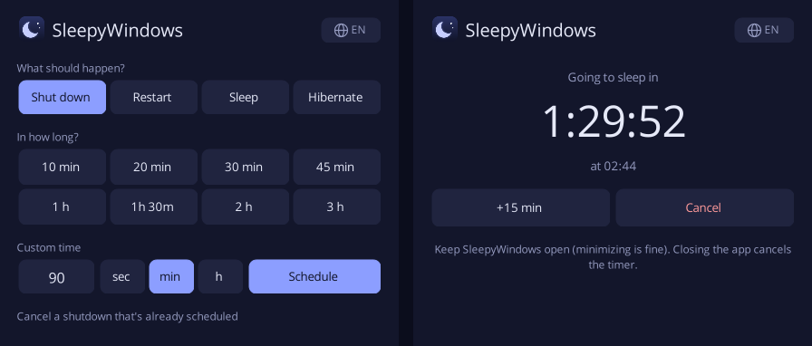

<p align="center">
  
</p>

<h1 align="center">SleepyWindows</h1>

<p align="center">
  A simple, portable timer to shut down, restart, sleep or hibernate Windows.<br>
  Available in 16 languages.
</p>

<p align="center">
  <a href="https://github.com/MaloneFreak/SleepyWindows/releases/latest"><b>⬇ Download SleepyWindows.exe</b></a>
</p>

<p align="center">
  
</p>

## Features

- Pick an action: **Shut down**, **Restart**, **Sleep** or **Hibernate**.
- Click a preset (10 min, 20 min, 30 min, 45 min, 1 h, 1 h 30, 2 h, 3 h) and it's scheduled.
- Or type a custom time in **seconds, minutes or hours** (up to 999 hours) and click **Schedule** (or press Enter).
- Shows a countdown and the exact time it will happen.
- **+15 min** to snooze, **Cancel** to call it off.
- **Portable**: a single `.exe` under 200 KB. Nothing to install, nothing written to the registry.
- **16 languages**, picked automatically from your Windows language, with a globe button to switch.

## How to use

1. Download `SleepyWindows.exe` from [Releases](https://github.com/MaloneFreak/SleepyWindows/releases/latest) and put it anywhere (desktop, USB stick...).
2. Run it. If you see "Windows protected your PC", click **More info → Run anyway**. That happens with any app that doesn't have a paid code-signing certificate.
3. Pick the action and the time.

## How it works

- **Shut down and Restart** use Windows' own scheduler (`shutdown /s /t` and `shutdown /r /t`).
  Once scheduled, **you can close the app**: Windows will still shut down.
  To call it off after closing the app, open it again and click *Cancel a shutdown that's already scheduled* (same as `shutdown /a`).
  Note: with a timeout above zero, Windows force-closes open programs, so save your work.
- **Sleep and Hibernate** have no built-in timer in Windows, so the app keeps the countdown itself and suspends the PC at the end.
  In this mode the **app has to stay open** (minimizing is fine). One minute before, the window comes back to the front so you can still cancel.
- **Hibernate** is greyed out when hibernation is turned off. To turn it on, run `powercfg /h on` in an administrator Command Prompt.

## Languages

| | | | |
|---|---|---|---|
| English | Português | Español | Français |
| Deutsch | Italiano | Nederlands | Polski |
| Русский | Українська | Türkçe | Bahasa Indonesia |
| 日本語 | 简体中文 | 繁體中文 | 한국어 |

SleepyWindows follows your Windows display language. To use a different one, click the globe button in the top-right corner.
A language picked by hand is remembered in `%AppData%\SleepyWindows\settings.ini`. Choosing *Automatic* again deletes that file.

### Adding or fixing a translation

Translations are plain text files in [`lang/`](lang), one per language, in `key = value` format.
They are built into the `.exe`, so the app stays a single file.

1. Copy [`lang/en.txt`](lang/en.txt) to `lang/<code>.txt`, using the language code (e.g. `sv.txt`, `cs.txt`, `pt-PT.txt`).
2. Set `_name` to the language's own name (e.g. `Svenska`) and translate the values. Keep `{0}` and `{1}` as they are.
3. Check it with `python tools/check-translations.py` and open a pull request.

No code changes are needed: every file in `lang/` is picked up automatically. Any key you leave out falls back to English.
Corrections to the existing translations are very welcome too.

## Requirements

Windows 10 or 11. Nothing to install: the app runs on the .NET Framework that ships with Windows.
It should also work on Windows 7 and 8.1 with .NET Framework 4.6.2 or newer installed.

## Building from source

With the [.NET SDK](https://dotnet.microsoft.com/download) 6 or newer:

```
dotnet build -c Release
```

The executable ends up in `bin/Release/net462/SleepyWindows.exe`.
Every `v*` tag pushed to GitHub builds the app on Windows and attaches the `.exe` to the release (see [`.github/workflows/build.yml`](.github/workflows/build.yml)).

## Project layout

```
src/
  Program.cs        entry point, single-instance check
  MainForm.cs       the window: presets, custom time, countdown, language menu
  PowerControl.cs   shutdown.exe calls and sleep/hibernate
  Strings.cs        loads the translations and picks the language
  Settings.cs       remembers a hand-picked language
  Controls.cs       dark theme, rounded buttons, number box, menu colors
  NativeMethods.cs  dark title bar, hibernate check
lang/               one translation file per language
tools/              translation checker
assets/             icons
```

## License

[MIT](LICENSE)
